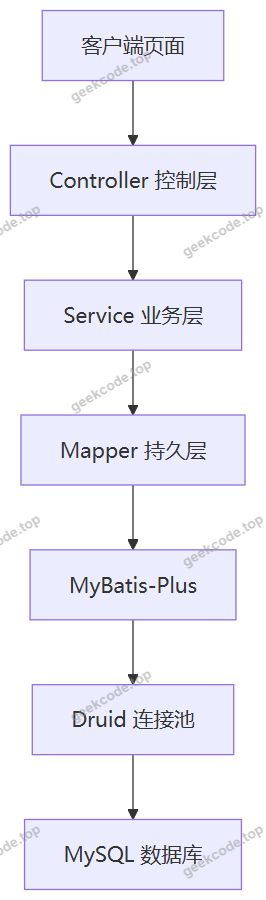
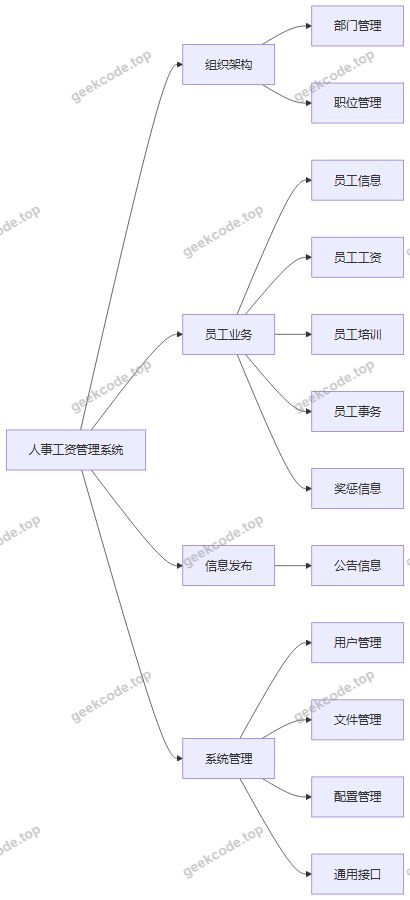
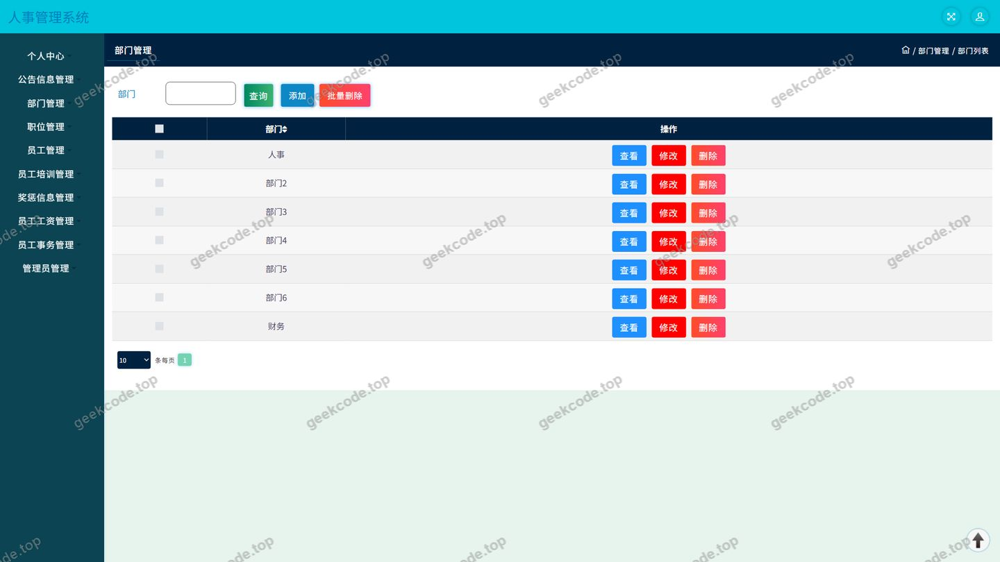
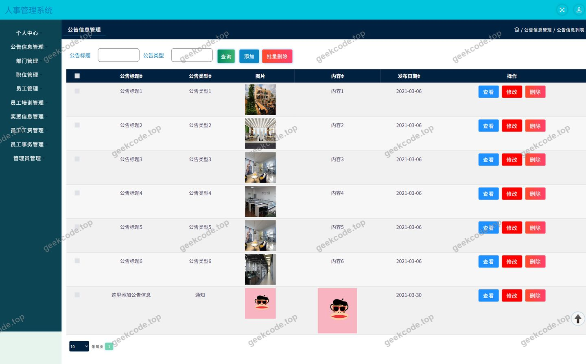
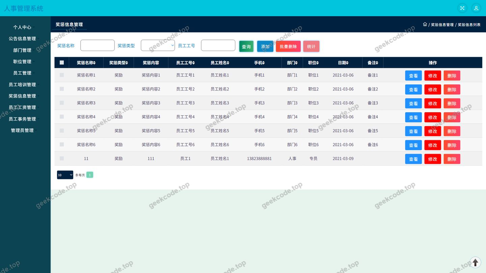
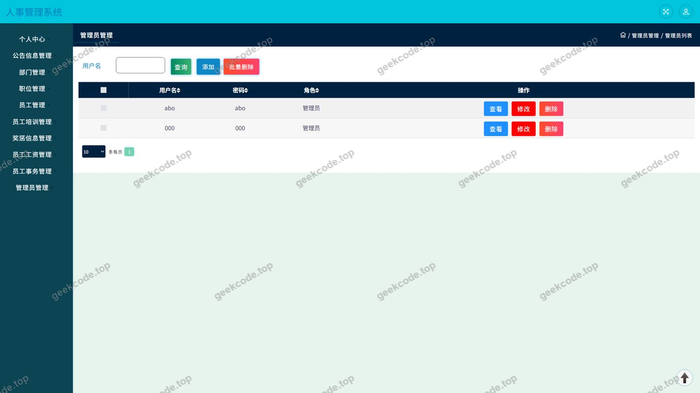
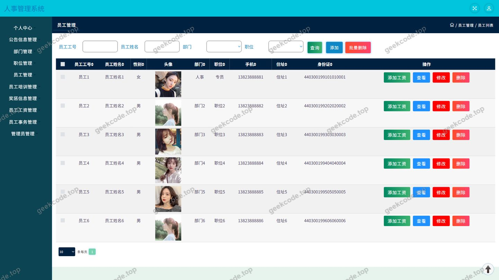
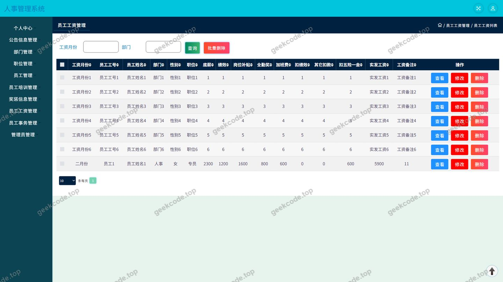
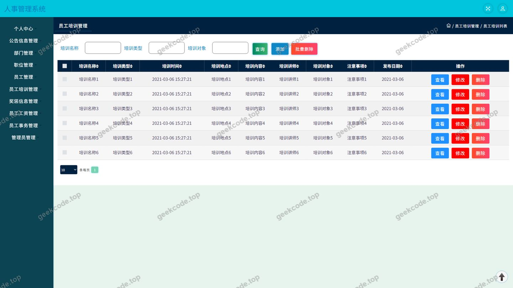
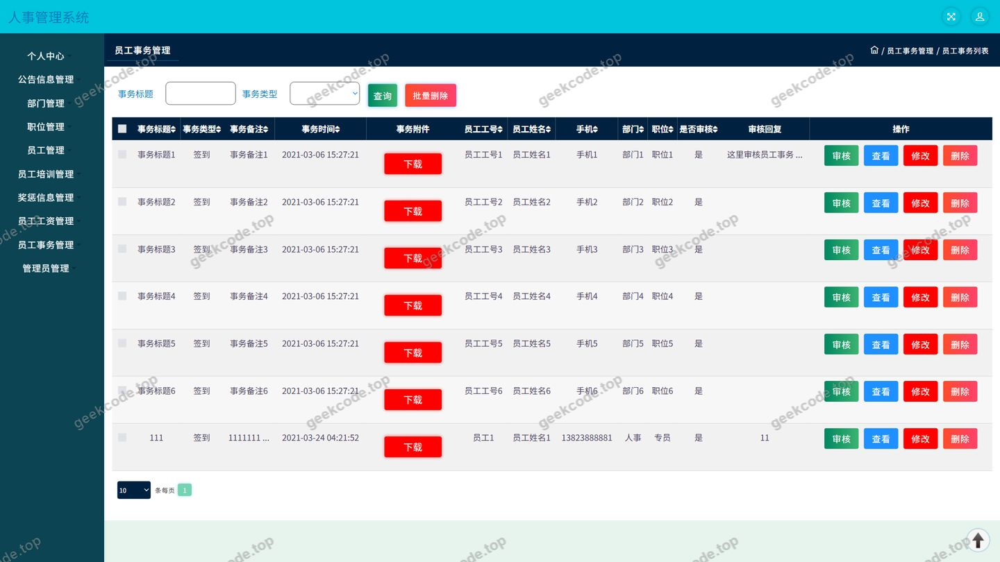

# java项目-ssm人事工资管理系统-ssm毕业设计-带论文

> 🎓 **计算机毕业设计 · java项目-ssm人事工资管理系统-ssm毕业设计-带论文**
>
> 本仓库只放**项目介绍 + 运行截图**（截图是站点带水印的原图，存在仓库 `images/` 里）。
>
> 👉 **完整可运行源码 / 数据库脚本 / 部署文档：[点我获取](https://geekcode.top/archives/java%E9%A1%B9%E7%9B%AE-ssm%E4%BA%BA%E4%BA%8B%E5%B7%A5%E8%B5%84%E7%AE%A1%E7%90%86%E7%B3%BB%E7%BB%9F-ssm%E6%AF%95%E4%B8%9A%E8%AE%BE%E8%AE%A1-%E5%B8%A6%E8%AE%BA%E6%96%87?utm_source=github)**
>
> 💬 咨询微信：**ir9372**　|　🌐 更多项目：[极客代码 geekcode.top](https://geekcode.top/?utm_source=github)
>
> 📌 项目详情页：<https://geekcode.top/archives/java%E9%A1%B9%E7%9B%AE-ssm%E4%BA%BA%E4%BA%8B%E5%B7%A5%E8%B5%84%E7%AE%A1%E7%90%86%E7%B3%BB%E7%BB%9F-ssm%E6%AF%95%E4%B8%9A%E8%AE%BE%E8%AE%A1-%E5%B8%A6%E8%AE%BA%E6%96%87?utm_source=github>

<table><td width="230" align="center"> <b>扫码加微信 ir9372</b></td><td valign="middle">📦 源码 = 项目介绍 + 全部运行截图 + 数据库 + 部署文档 👉 点上方任意截图，直接跳到 <b>极客代码 geekcode.top</b> 详情页</td></table>

---

<h1>java项目-ssm人事工资管理系统-ssm毕业设计-带论文</h1>
<h2>项目概述</h2>

本项目为“人事工资管理系统”，是一套面向企事业单位人事部门的信息化管理系统，采用 Java 语言开发，属于纯 API 后端服务形态。系统核心功能围绕企业人事管理的完整业务链条展开，主要包括部门管理、职位管理、员工信息管理、员工工资管理、员工培训管理、员工事务管理、奖惩信息管理、公告信息管理以及系统用户管理等模块，覆盖从组织架构搭建、人员入职建档到薪酬核算、培训记录与奖惩事务登记的全过程管理需求。

系统目标是将传统人事工作中分散在纸质表格与 Excel 中的数据集中到统一平台，通过结构化的数据模型与标准化的接口服务，实现人事数据的规范存储、快速检索与统一维护，降低人事管理的人工成本与数据出错率。

适用人群为各类企事业单位的人事专员、人事主管及系统管理员，也可作为计算机专业毕业设计的参考项目。

技术架构上，系统基于 Spring 框架体系构建，使用 Spring MVC 处理请求分发、Spring 的 IoC 与事务管理组织业务逻辑，持久层采用 MyBatis-Plus 简化数据访问，数据库连接池使用 Druid 提供连接管理与监控能力。

<h2>技术架构</h2>
<h3>整体架构</h3>

本项目为纯 API 型服务，未划分独立的前台用户端工程与后台管理端工程，所有业务能力均以接口形式对外提供，由前端页面调用。整体采用经典的三层架构：表现层、业务层、持久层。

各层职责说明：

<ul>
<li>表现层（Controller）：由 12 个控制器组成，负责接收 HTTP 请求、参数校验与结果封装，不承载业务规则。控制器包括 BumenController、CommonController、ConfigController、FileController、GonggaoxinxiController、JiangchengxinxiController、UserController、YuangongController、YuangonggongziController、YuangongpeixunController、YuangongshiwuController、ZhiweiController。</li>
<li>业务层（Service）：基于 Spring 容器管理，通过 Spring 的声明式事务保证工资登记、员工信息变更等操作的原子性。</li>
<li>持久层（Mapper）：基于 MyBatis-Plus 构建，利用其通用 CRUD 能力减少重复的 SQL 编写工作，同时保留自定义 SQL 的扩展空间。</li>
</ul>
<h3>核心技术选型理由</h3>
<table>
<thead>
<tr>
<th>技术</th>
<th>版本定位</th>
<th>选型理由</th>
</tr>
</thead>
<tbody><tr>
<td>Spring Core / Context / Beans</td>
<td>核心容器</td>
<td>提供 IoC 容器与依赖注入，统一管理各层组件生命周期</td>
</tr>
<tr>
<td>Spring MVC</td>
<td>Web 层框架</td>
<td>基于注解的请求映射，与 Spring 容器无缝集成</td>
</tr>
<tr>
<td>Spring TX</td>
<td>事务管理</td>
<td>保证工资、奖惩等涉及多表操作的业务一致性</td>
</tr>
<tr>
<td>Spring AOP</td>
<td>切面编程</td>
<td>支撑日志、事务等横切关注点的统一处理</td>
</tr>
<tr>
<td>MyBatis-Plus</td>
<td>持久层框架</td>
<td>在 MyBatis 基础上提供通用 Mapper 与条件构造器，显著降低单表 CRUD 的代码量</td>
</tr>
<tr>
<td>Druid</td>
<td>数据库连接池</td>
<td>提供连接池管理、SQL 执行监控与慢 SQL 统计能力，便于调试与性能观察</td>
</tr>
</tbody></table>

依赖清单中出现 spring-web、spring-webmvc 等模块，但未包含内嵌 Servlet 容器相关依赖，因此系统需部署至外部 Servlet 容器中运行。

<h3>数据库设计要点</h3>

数据库设计围绕“组织—人员—业务记录”三条主线展开，从控制器与业务模块可以归纳出以下数据表设计要点：

<ol>
<li>组织架构维度：部门表与职位表相互独立，为员工信息提供所属部门与所属职位的可选值来源，形成企业与岗位的两级划分。</li>
<li>人员主数据：员工表作为核心主表，通过部门、职位等外键关联组织架构数据，是工资、培训、事务、奖惩等业务记录的关联主体。</li>
<li>业务记录表：员工工资表、员工培训表、员工事务表、奖惩信息表均以员工为关联对象，每条记录对应一次具体的业务事件，便于按员工维度汇总查询。</li>
<li>信息发布：公告信息表用于存放面向系统使用者发布的通知类内容。</li>
<li>系统管理：用户表承担登录账号与身份信息存储职责，配置表与文件表分别承担系统参数存储与文件资源管理职责。</li>
</ol>

数据访问层统一由 MyBatis-Plus 提供的通用能力完成，实体与数据表之间保持字段一一对应。

<h2>功能模块</h2>

根据现有信息，本项目为纯 API 后端服务，未划分前台用户端与后台管理端，功能模块以控制器为单位对外提供接口能力，具体划分如下。

<h3>组织架构与基础数据模块</h3>
<ul>
<li>部门管理（BumenController）：维护企业部门信息，支持部门的查询与增删改操作，为员工信息提供部门归属数据。</li>
<li>职位管理（ZhiweiController）：维护岗位/职位信息，供员工建档时选择对应职位。</li>
<li>员工信息管理（YuangongController）：员工档案的建立与维护，是系统所有人事业务数据的关联主体。</li>
</ul>
<h3>薪酬与业务记录模块</h3>
<ul>
<li>员工工资管理（YuangonggongziController）：登记与查询员工的工资发放记录，按员工维度管理薪酬数据。</li>
<li>员工培训管理（YuangongpeixunController）：记录员工参加的培训信息，形成培训档案。</li>
<li>员工事务管理（YuangongshiwuController）：管理员工日常事务类记录（如调岗、离职等事务登记由业务数据决定）。</li>
<li>奖惩信息管理（JiangchengxinxiController）：记录员工的奖励与惩罚信息，作为绩效考核的参考依据。</li>
</ul>
<h3>信息发布模块</h3>
<ul>
<li>公告信息管理（GonggaoxinxiController）：发布与维护公告内容，供系统使用者查阅。</li>
</ul>
<h3>系统管理模块</h3>
<ul>
<li>用户管理（UserController）：管理系统登录账号，支撑登录页面的身份校验。</li>
<li>通用接口（CommonController）：提供公共数据查询或通用处理能力。</li>
<li>配置管理（ConfigController）：维护系统运行所需的配置项。</li>
<li>文件管理（FileController）：提供文件上传、下载等资源管理能力。</li>
</ul>

<h2>用户角色与权限</h2>

系统提供登录页面与用户管理模块，说明系统具备基于账号的身份校验机制。根据现有信息，系统的角色划分方式与权限粒度无法进一步确定，以下按功能用途归纳系统中主要使用者类型及其可操作的功能模块。

<h3>系统管理员</h3>

系统管理员负责系统的基础配置与账号维护，可访问的功能模块包括：

<ul>
<li>用户管理：维护系统登录账号信息，包括账号的查看与维护。</li>
<li>配置管理：维护系统运行参数。</li>
<li>文件管理：管理系统中上传与存储的文件资源。</li>
<li>通用接口：调用系统公共处理能力。</li>
<li>组织架构与业务模块的完整访问权限：部门管理、职位管理、员工信息管理、员工工资管理、员工培训管理、员工事务管理、奖惩信息管理、公告信息管理。</li>
</ul>
<h3>人事管理员</h3>

人事管理员是系统的主要业务使用者，负责日常人事数据的录入与维护，根据登录账号进入系统后可访问的功能模块包括：

<ul>
<li>部门管理：查看与维护部门信息。</li>
<li>职位管理：查看与维护职位信息。</li>
<li>员工信息管理：录入与维护员工档案。</li>
<li>员工工资管理：登记与查询员工工资记录。</li>
<li>员工培训管理：录入员工培训记录。</li>
<li>员工事务管理：登记员工事务记录。</li>
<li>奖惩信息管理：登记与查询员工奖惩信息。</li>
<li>公告信息管理：发布与查阅公告内容。</li>
</ul>
<h3>普通员工</h3>

根据现有信息，未提供员工自助查询类页面与独立的员工端入口，因此无法确定是否存在面向普通员工的自助服务角色及其权限范围。

<h2>项目特色与创新点</h2>
<ol>
<li>
业务链条完整，覆盖人事管理全流程。系统将部门、职位、员工、工资、培训、事务、奖惩等环节纳入统一的数据模型，避免了人事数据分散在多个 Excel 表格中导致的信息孤岛问题。员工作为核心主数据，向上关联组织架构，向下关联工资、培训、事务与奖惩记录，形成完整的人事数据视图。

</li>
<li>
持久层采用 MyBatis-Plus 降低开发成本。相比原生 MyBatis，通过通用 Mapper 与条件构造器显著减少了单表增删改查的样板代码，使开发者能够将精力集中在业务逻辑与复杂查询上，同时也保留了手写 SQL 的灵活性。

</li>
<li>
使用 Druid 连接池提升可观测性。Druid 提供的连接池监控与 SQL 统计能力，便于在开发与运维阶段定位慢查询与连接泄漏问题，为系统的稳定性提供支撑。

</li>
<li>
基于 Spring 声明式事务保障数据一致性。员工信息变更、工资登记等涉及多表写入的操作被纳入事务管理范围，有效降低数据不一致风险。

</li>
<li>
分层清晰，职责边界明确。Controller 层仅负责请求接入与结果返回，业务规则集中在 Service 层，数据访问统一收敛到 Mapper 层，便于后续功能扩展与代码维护。

</li>
</ol>
<h2>部署环境</h2>
<h3>运行环境</h3>
<table>
<thead>
<tr>
<th>类别</th>
<th>要求</th>
</tr>
</thead>
<tbody><tr>
<td>JDK</td>
<td>JDK 8（与所用 Spring 框架版本对应）</td>
</tr>
<tr>
<td>Servlet 容器</td>
<td>Tomcat 8.5 及以上（依赖中未包含内嵌容器，需外部容器部署）</td>
</tr>
<tr>
<td>数据库</td>
<td>MySQL（关系型数据库，用于存储人事、工资、用户等数据）</td>
</tr>
<tr>
<td>连接池</td>
<td>Druid</td>
</tr>
<tr>
<td>构建工具</td>
<td>Maven（依据依赖清单的坐标管理方式）</td>
</tr>
<tr>
<td>操作系统</td>
<td>支持 JDK 与 Tomcat 的 Windows 或 Linux 系统</td>
</tr>
</tbody></table>
<h3>项目构建与启动</h3>
<ol>
<li>安装并配置 JDK 8，设置 JAVA_HOME 环境变量。</li>
<li>安装 MySQL 数据库，创建数据库实例并导入项目提供的数据表结构与初始数据。</li>
<li>修改数据库连接配置，配置数据库地址、端口、库名、用户名与密码，以及 Druid 连接池参数。</li>
<li>使用 Maven 执行构建，生成部署包。</li>
<li>将部署包放入 Tomcat 的 webapps 目录，启动 Tomcat 完成服务发布。</li>
<li>通过浏览器访问系统页面，使用用户管理模块中的账号完成登录。</li>
</ol>
<h3>无需安装的组件</h3>

本项目为纯 API 后端服务，未包含前端工程与移动端工程，因此不需要安装 Node.js，也不需要使用微信开发者工具。

<h3>数据库准备要点</h3>

数据库需包含部门、职位、员工、员工工资、员工培训、员工事务、奖惩信息、公告信息、系统用户、系统配置及文件资源等数据表，各业务表通过员工标识与员工主表建立关联。建库时应根据实际数据量对员工编号、部门编号等检索字段建立索引，以提升列表查询与统计效率。

<h2>五、技术特性</h2>
<ul>
<li>使用 MyBatis-Plus 简化数据访问层开发</li>
</ul>
<h2>六、功能模块截图</h2>
<h3>后台管理端</h3>
<h4>页面-部门</h4>

<h4>页面-登录</h4>

<h4>页面-公告信息</h4>

<h4>页面-奖惩信息</h4>

<h4>页面-用户</h4>

<h4>页面-员工</h4>

<h4>页面-员工工资</h4>

<h4>页面-员工培训</h4>

<h4>页面-员工事务</h4>

---

## 获取完整源码

| 项目 | 说明 |
| --- | --- |
| 项目名 | java项目-ssm人事工资管理系统-ssm毕业设计-带论文 |
| 运行截图 | 本文 11 张（站点带水印原图，仓库 `images/` 目录） |
| 完整源码 | [https://geekcode.top/archives/java%E9%A1%B9%E7%9B%AE-ssm%E4%BA%BA%E4%BA%8B%E5%B7%A5%E8%B5%84%E7%AE%A1%E7%90%86%E7%B3%BB%E7%BB%9F-ssm%E6%AF%95%E4%B8%9A%E8%AE%BE%E8%AE%A1-%E5%B8%A6%E8%AE%BA%E6%96%87?utm_source=github](https://geekcode.top/archives/java%E9%A1%B9%E7%9B%AE-ssm%E4%BA%BA%E4%BA%8B%E5%B7%A5%E8%B5%84%E7%AE%A1%E7%90%86%E7%B3%BB%E7%BB%9F-ssm%E6%AF%95%E4%B8%9A%E8%AE%BE%E8%AE%A1-%E5%B8%A6%E8%AE%BA%E6%96%87?utm_source=github) |
| 咨询微信 | **ir9372**（备注：jingpin-yuanma） |
| 更多项目 | [极客代码 geekcode.top](https://geekcode.top/?utm_source=github) |

> 需要源码、部署、改配置、跑不起来等问题，加微信 ir9372 沟通，说明项目名即可。
